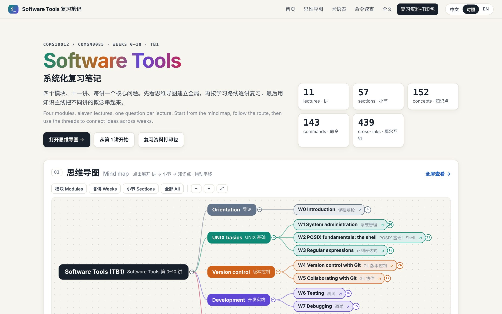
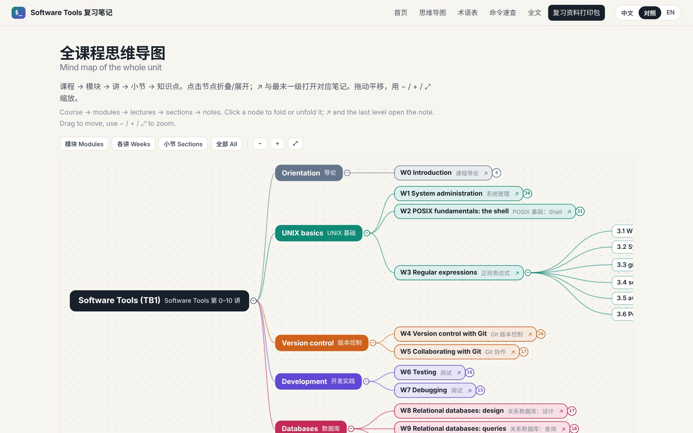
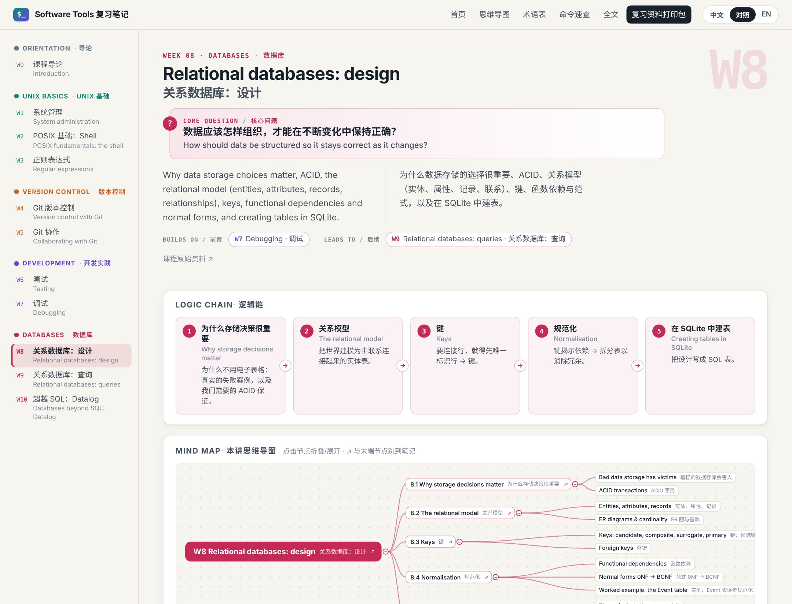
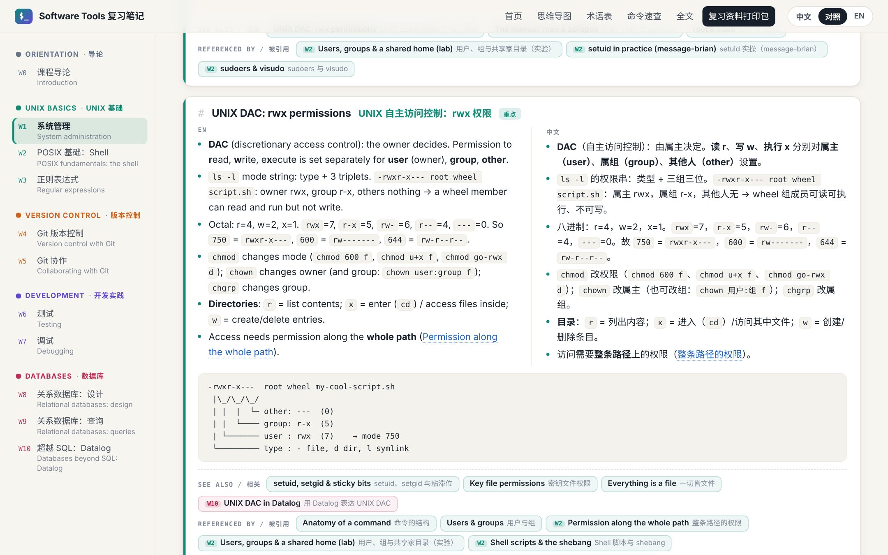
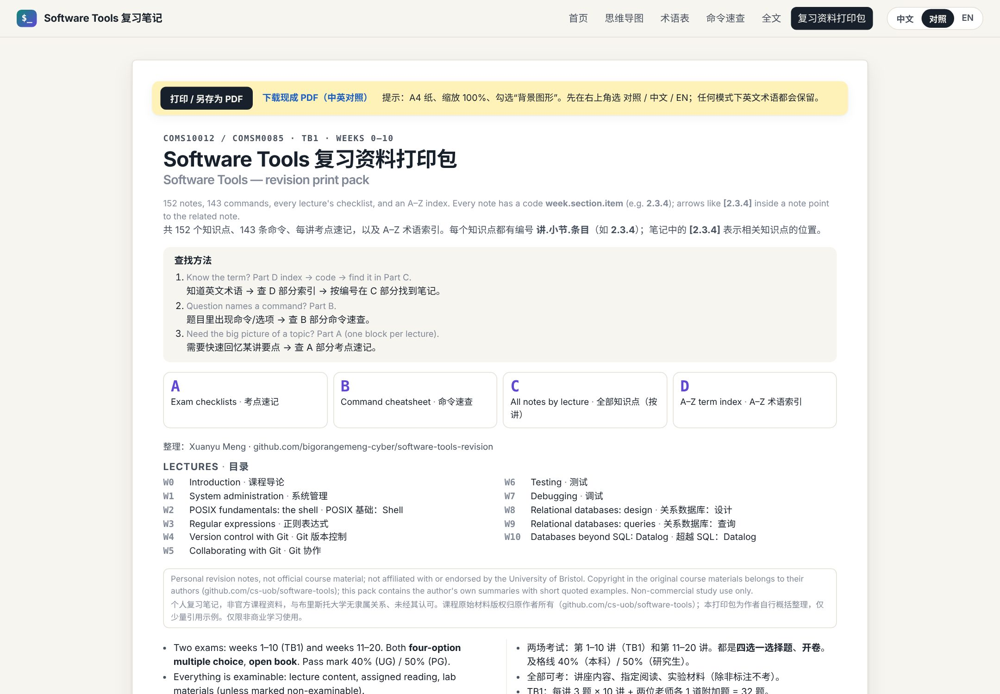

<div align="center">

# Software Tools · 系统化复习笔记

**Bilingual (中文 / English) revision site for _Software Tools_ (COMS10012 / COMSM0085), University of Bristol — Weeks 0–10 (TB1)**

[](https://bigorangemeng-cyber.github.io/software-tools-revision/)
[](https://bigorangemeng-cyber.github.io/software-tools-revision/mindmap.html)
[](https://bigorangemeng-cyber.github.io/software-tools-revision/print.html)

`152` concepts · `143` commands · `439` cross-links · `11` lectures · zero dependencies

作者 Author: **Xuanyu Meng** · [bigorangemeng-cyber](https://github.com/bigorangemeng-cyber)

</div>



## 这是什么 · What it is

把 Software Tools 第 0–10 讲（UNIX、Git、测试与调试、SQL 与 Datalog）整理成一个**体系化、可互相跳转**的复习网站：不是逐页翻译课件，而是按“模块 → 讲 → 小节 → 知识点”重新组织的笔记，每个概念都链接到它依赖和相关的概念。

A structured, cross-linked set of revision notes for the first term of *Software Tools*. Every lecture is reorganised around one core question, every section explains why it follows the previous one, and every concept links to the concepts it depends on.

## 功能 · Features

| | 功能 | Feature |
|---|---|---|
| 🧠 | **交互式思维导图**：课程 → 模块 → 讲 → 小节 → 知识点，可折叠、缩放、拖动，点击直达笔记 | Interactive mind map of the whole unit, collapsible and zoomable, every leaf links to its note |
| ❓ | **每讲一个核心问题 + 逻辑链**：说明每一节解决什么、为什么接在上一节之后 | One core question per lecture and a logic chain linking its sections |
| 🔗 | **概念互链**：正文内链接、“相关”与自动生成的“被引用”反向链接 | Inline links, see-also and auto-generated *referenced by* backlinks |
| 🧵 | **8 条知识主线**：如权限（W1 rwx → W2 setuid → W10 Datalog 访问控制）、安全、Git 时间旅行 | 8 threads that follow one idea across weeks |
| 🌐 | **中文 / 对照 / EN 一键切换**，英文术语始终保留（考试是英文） | Chinese / side-by-side / English switch; English terms always visible |
| 📖 | **术语表 + 命令速查**，中英文都可筛选 | Filterable glossary and command cheatsheet |
| 🖨️ | **复习资料打印包**：考点速记、命令速查、全部笔记（带编号）、A–Z 索引，A4 排版，附现成 PDF | Revision print pack for A4 printing, with a ready-made PDF |
| 📱 | 手机、深色模式、打印均已适配 | Works on mobile, dark mode and print |

## 截图 · Screenshots

| 思维导图 · Mind map | 每讲页面 · Lecture page |
|---|---|
|  |  |
| **知识点卡片 · Concept note** | **复习资料打印包 · Revision print pack** |
|  |  |

## 内容 · Contents

| 模块 Module | 讲 Lecture | 核心问题 Core question |
|---|---|---|
| 导论 Orientation | [W0 课程导论 Introduction](https://bigorangemeng-cyber.github.io/software-tools-revision/w00.html) | 这门课学什么？怎么考？ |
| UNIX 基础 | [W1 系统管理 System administration](https://bigorangemeng-cyber.github.io/software-tools-revision/w01.html) | 怎样登上一台 UNIX 机器，并像管理员一样管理它？ |
| | [W2 POSIX 基础：Shell](https://bigorangemeng-cyber.github.io/software-tools-revision/w02.html) | 我敲的一行命令，shell 到底做了什么？ |
| | [W3 正则表达式 Regular expressions](https://bigorangemeng-cyber.github.io/software-tools-revision/w03.html) | 怎样描述文本模式？哪些工具使用它？ |
| 版本控制 | [W4 Git 版本控制](https://bigorangemeng-cyber.github.io/software-tools-revision/w04.html) | 怎样记录项目历史，并在历史中来回穿梭？ |
| | [W5 Git 协作](https://bigorangemeng-cyber.github.io/software-tools-revision/w05.html) | 多人修改同一项目，怎样不丢失工作？ |
| 开发实践 | [W6 测试 Testing](https://bigorangemeng-cyber.github.io/software-tools-revision/w06.html) | 怎样确认代码正确，并自动保持正确？ |
| | [W7 调试 Debugging](https://bigorangemeng-cyber.github.io/software-tools-revision/w07.html) | 代码出错时，怎样找出原因——即使没有源码？ |
| 数据库 | [W8 关系数据库：设计](https://bigorangemeng-cyber.github.io/software-tools-revision/w08.html) | 数据应怎样组织，才能在变化中保持正确？ |
| | [W9 关系数据库：查询](https://bigorangemeng-cyber.github.io/software-tools-revision/w09.html) | 怎样从关系数据库里查出答案？ |
| | [W10 超越 SQL：Datalog](https://bigorangemeng-cyber.github.io/software-tools-revision/w10.html) | 程序怎样安全地用数据库？递归问题怎么办？ |

## 推荐用法 · How to use

1. 先看 **[思维导图](https://bigorangemeng-cyber.github.io/software-tools-revision/mindmap.html)** 建立全局。 Start with the mind map.
2. 按**学习路线**逐讲复习：核心问题 → 逻辑链 → 知识点卡片 → 考点速记。 Work through each lecture in order.
3. 用首页的**知识主线**把不同讲的概念串起来。 Use the threads to connect ideas across weeks.
4. 需要纸质版时打印 **[复习资料打印包](https://bigorangemeng-cyber.github.io/software-tools-revision/print.html)**（或直接下载 [PDF](https://bigorangemeng-cyber.github.io/software-tools-revision/exam-pack-bilingual.pdf)）。 Print the revision pack if you prefer paper.

## 本地运行与修改 · Build locally

纯静态 HTML/CSS/JS，无需安装任何依赖；直接双击 `index.html` 即可离线浏览。所有页面由 `src/` 中的 Python 脚本生成（Python 3.8+，仅用标准库）：

Plain static files, no dependencies. All pages are generated from the Python sources in `src/`:

```bash
python3 src/build.py      # regenerate every page; stops and lists any broken [[link]]
```

```
src/
├── build.py      # generator: pages, mind-map data, print pack, glossary, cheatsheet
├── model.py      # tiny content model: W() week, S() section, c() concept, cmd() command
├── c_weeks.py    # modules, lecture summaries, exam checklists, threads
├── c_logic.py    # core question per lecture, one-line logic per section
├── c_unix.py     # W0–W3   c_git.py  W4–W5
├── c_dev.py      # W6–W7   c_db.py   W8–W10
assets/           # style.css · app.js (language switch, filters) · mindmap.js (interactive SVG mind map)
```

一个知识点长这样 · A concept looks like this:

```python
c("grep", "grep", "grep 搜索", exam=True,
  en=r"""- Prints every line matching a regex … see [[regex]]""",
  zh=r"""- 打印所有匹配正则的行…… 参见 [[regex]]""",
  code=r"""grep -ic 'q' /usr/share/dict/words""",
  see=["sed", "filters"])
```

## 作者与声明 · Author & disclaimer

**作者 Author**：Xuanyu Meng（[bigorangemeng-cyber](https://github.com/bigorangemeng-cyber)），布里斯托大学学生。本项目为独立的个人学习整理。
A personal, independent study project by Xuanyu Meng, a student at the University of Bristol.

- **无隶属关系 · No affiliation**：本站与布里斯托大学、计算机学院及 Software Tools 教学团队无隶属关系，未经其审核或认可，不是官方课程资料。
  Not affiliated with, reviewed or endorsed by the University of Bristol or the Software Tools teaching team; not official course material.
- **课程材料版权 · Copyright of course materials**：课程原始材料（讲座、幻灯片、实验文档、示例代码、样例数据库）的版权归布里斯托大学及各自作者所有，原始材料见 [cs-uob/software-tools](https://github.com/cs-uob/software-tools)。本仓库内容为作者用自己的话所做的概括、翻译与重新组织；仅在说明需要时少量引用命令、代码片段和示例，并注明出处；未转载任何完整的讲义、幻灯片、实验文档或往年试题。
  Copyright in the original course materials belongs to the University of Bristol and their authors. This repository contains the author's own summaries, translations and re-organisation, quoting only short commands, snippets and examples where needed, with attribution. No complete lecture, slide deck, lab sheet or past exam paper is reproduced.
- **使用范围 · Use**：仅供非商业的个人学习与复习交流，请勿出售或商业转载；凡涉及考核，以课程官方材料和考试说明为准。
  Non-commercial personal study only; for anything assessed, follow the official materials and exam instructions.
- **准确性 · Accuracy**：可能存在错误或遗漏，不构成官方答案，欢迎通过 Issues 指正。 May contain mistakes; corrections welcome via Issues.
- **制作方式 · How it was made**：在 AI 工具辅助下整理与排版。 Organised and formatted with the help of AI tools.
- **删除请求 · Removal requests**：如权利人认为任何内容不宜公开，请[提交 Issue](https://github.com/bigorangemeng-cyber/software-tools-revision/issues)，作者会尽快修改或删除。 Rights holders can open an issue and the content will be corrected or removed promptly.

作者自己撰写的文字、结构、代码与设计 © 2026 Xuanyu Meng。 The author's own text, structure, code and design © 2026 Xuanyu Meng.
